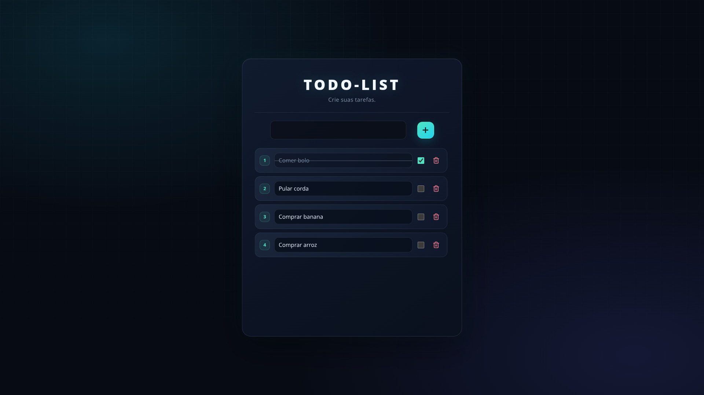

# TODO-LIST


Aplicação para gerenciar tarefas, com interface web, API em Node.js e persistência em PostgreSQL.

## Demonstração



## Funcionalidades

- Criar tarefas.
- Listar tarefas.
- Editar tarefas.
- Marcar tarefas como concluídas.
- Excluir tarefas.

## Tecnologias

- HTML, CSS e JavaScript.
- Node.js e Express.
- PostgreSQL.
- Vite.
- Zod.

## Estrutura

- `client/`: interface e comunicação com a API.
- `server/`: API e acesso ao banco de dados.

## Como executar

### Pré-requisitos

- **Node.js:** `v24.x`.
- **Gerenciador de pacotes:** `npm`.
- **PostgreSQL.**

### 1. Clonar o repositório

```bash
git clone https://github.com/HennagoX/To-Do-list.git
cd To-Do-list
```

### 2. Configurar e iniciar a API

```bash
cd server
npm install
```

Crie um arquivo `.env` seguindo o exemplo de `example_env.txt` e configure as variáveis de ambiente.

Certifique-se de que o PostgreSQL esteja em execução e crie o banco de dados com o nome configurado no `.env`.

Execute as migrations para criar a estrutura do banco:
```bash
npm run migrate up
```

Em seguida, inicie a API:

```bash
npm start
```

### 3. Iniciar o front-end

Em outro terminal, a partir da raiz do repositório:

```bash
cd client
npm install
```

Configure a URL da API na constante `TASKS_URL`, localizada no arquivo `client/src/js/api.js`.

Inicie o servidor de desenvolvimento:

```bash
npm run dev
```

Outros comandos disponíveis:

- `npm run build`: gera os arquivos otimizados para produção.
- `npm run preview`: permite visualizar localmente a versão gerada pelo build. Execute `npm run build` antes.

> O comando `npm run preview` serve para conferir o build localmente, não para hospedar a aplicação em produção.

## Rotas da API

| Método | Rota | Descrição |
|--------|------|-----------|
| GET | /api/tasks | Lista as tarefas |
| POST | /api/tasks | Cria uma tarefa |
| PATCH | /api/tasks/:id | Atualiza uma tarefa |
| DELETE | /api/tasks/:id | Exclui uma tarefa |

## Aprendizados

Durante o desenvolvimento do projeto, pratiquei a comunicação entre o client web e a API em Node.js, além da persistência de dados no PostgreSQL. Aprofundei meus conhecimentos sobre convenções de código e nomenclatura de rotas em APIs REST.

Também implementei a validação de dados com schemas do Zod para verificar se as entradas atendem ao formato e às regras esperadas, além do tratamento de erros para lidar com falhas de forma controlada e retornar respostas adequadas ao client.

## Próximas melhorias

- [ ] Cadastro e login.
- [ ] Tarefas vinculadas a usuários.